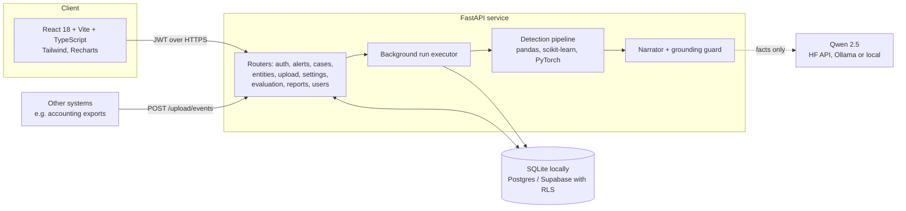
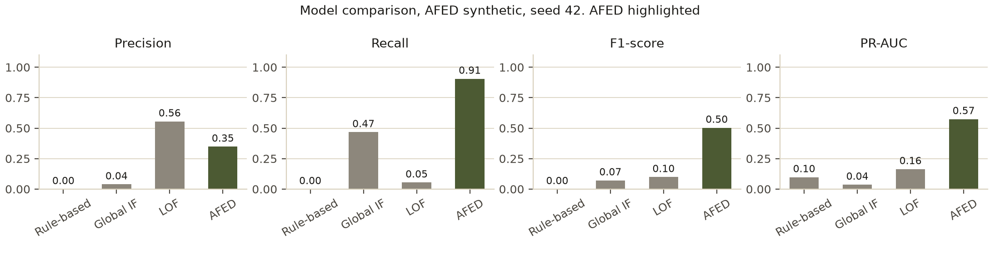
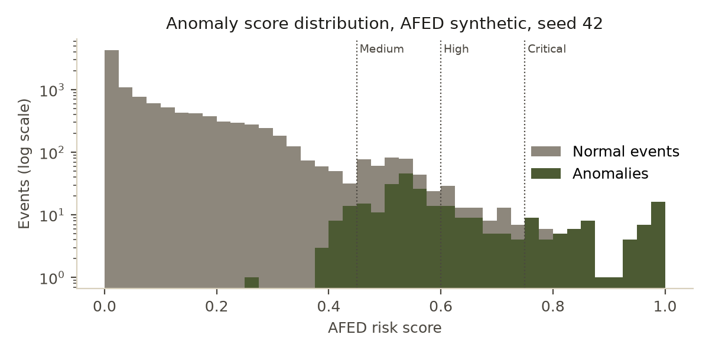
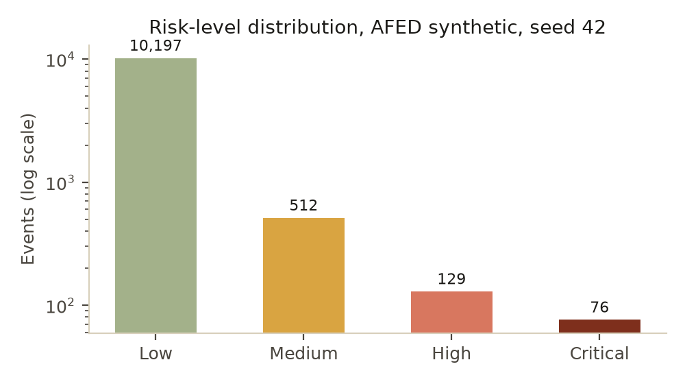
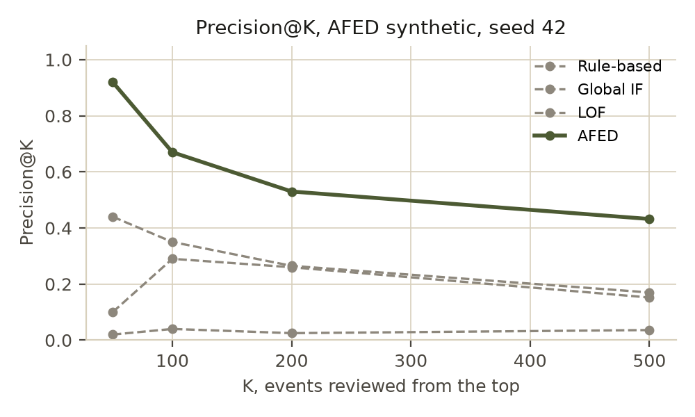
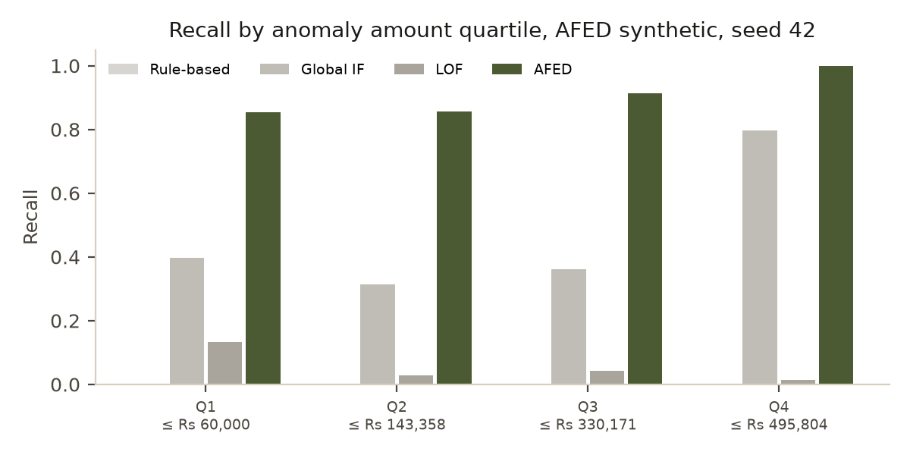

# AFED: Automated Fraud and Event Detection

**A project report on entity-relative anomaly detection for vendor and procurement payments, with grounded
explanations and a human review workflow**

Report date: 9 November 2026. Every number below comes from a result file in this repository; the file is named
next to each table so it can be checked or regenerated.

---

## Contents

1. [Abstract](#1-abstract)
2. [Introduction](#2-introduction)
3. [Background and related work](#3-background-and-related-work)
4. [System architecture](#4-system-architecture)
5. [Data](#5-data)
6. [Methodology: the detection pipeline](#6-methodology-the-detection-pipeline)
7. [Explanations and the grounding guard](#7-explanations-and-the-grounding-guard)
8. [The application: pages, roles and workflows](#8-the-application-pages-roles-and-workflows)
9. [Evaluation methodology](#9-evaluation-methodology)
10. [Results](#10-results)
11. [Security and privacy](#11-security-and-privacy)
12. [Testing and quality](#12-testing-and-quality)
13. [Demonstration guide](#13-demonstration-guide)
14. [Limitations and threats to validity](#14-limitations-and-threats-to-validity)
15. [Future work](#15-future-work)
16. [Decisions log](#16-decisions-log)
17. [How to run](#17-how-to-run)
18. [Appendices](#18-appendices)
19. [Bibliography](#19-bibliography)

---

## 1. Abstract

Public bodies and companies pay thousands of vendor invoices a month, and audit teams can check only a few.
Rule-based controls judge every invoice against the same global thresholds, so a payment that is ordinary for
one vendor and extraordinary for another looks the same to them. AFED (Automated Fraud and Event Detection)
judges each payment against that vendor's own history, or its peers' while the history is short. It combines
three signals: an Isolation Forest over the payment's features, a robust deviation from the vendor's own
normal band, and ten deterministic red-flag rules. These are fused into one risk score and four tiers. Every
alert carries computed facts, written into plain English or Hindi either by a template or by the Qwen language
model under a strict grounding check that rejects any wording not supported by the facts. Reviewers confirm,
dismiss or escalate alerts, and their decisions can recalibrate the scoring, but only if the new settings hold
up on reviews they were not fitted to.

On labelled synthetic procurement data (three seeds), AFED reaches F1 0.513 ± 0.009, recall 0.898, PR-AUC
0.567, ROC-AUC 0.982 and balanced accuracy 0.928. The best of the rule-based, global Isolation Forest and LOF
baselines reaches F1 0.098. On four real payment ledgers with seeded, planted anomalies, every model scores F1
between 0.02 and 0.06. AFED is best on two Indian ledgers (NSPCL, MPLADS) and behind a global Isolation Forest
on two US ledgers (Chicago, Delaware). A pre-registered test shows that choosing the alert threshold on each
ledger's own past more than doubles F1 on three of them, by cutting false alarms rather than by catching more.
The report states all of these results, because the real-data ones are the more realistic.

---

## 2. Introduction

### 2.1 The problem

Procurement fraud and error rarely look large in absolute terms. They look large for the vendor involved:

> A Rs. 4.8 lakh invoice sits under a Rs. 5 lakh approval limit, so a global rule lets it through. For a vendor
> who usually bills Rs. 50,000, it is 9.6 times normal.

Common schemes are designed to slip under global controls: splitting one purchase into several invoices just
below the approval limit, duplicate invoices, a changed bank account, a new vendor paid a large sum, the same
person creating and approving a payment, approvals at night or in a rush. A detector that only asks "is this
amount large?" misses most of them, and one that flags every unusual payment buries reviewers in false alarms.

### 2.2 Objectives

1. Score every payment for risk relative to its own vendor's history, with a peer fallback for short histories.
2. Explain every alert in plain language, using only computed facts, never invented reasons or accusations.
3. Support the people who act on alerts: a review queue, cases, reports, roles and an audit trail.
4. Learn from reviewers' decisions without fooling itself.
5. Measure all of this honestly: equal-budget comparisons, several seeds, pre-registered tests, and real data.

### 2.3 Contributions

- **Entity-relative fusion.** A risk score combining a global Isolation Forest, a one-sided robust deviation
  from the vendor's own band, and noisy-OR red-flag rules, with a bonus when deviation and rules agree.
- **Grounded narration.** A language model may only reword computed facts; a vocabulary and number check
  rejects anything else and falls back to a template.
- **A complete review application.** FastAPI and React, with four enforced roles, cases, PDF and CSV reports,
  Hindi explanations, notifications, an audit log, automatic intake from other systems, and row-level security
  on Postgres.
- **An honest evaluation.** A four-model comparison, an ablation, three pre-registered experiments committed
  before they ran, and evaluation on nine real ledgers (six of them Indian), with planted anomalies tagged and
  never mixed with the real rows.

### 2.4 Scope and stance

AFED flags events for human review. **A flag is not a finding of wrongdoing.** No dataset used here has
confirmed-fraud labels, so the report measures anomaly detection, and reports no "fraud detection rate".

---

## 3. Background and related work

- **Anomaly detection.** Chandola, Banerjee and Kumar [5] survey the field. Fraud detection is usually framed
  as unsupervised or semi-supervised anomaly detection because confirmed labels are scarce and biased [13].
- **Isolation Forest** [1] isolates points with random axis-parallel splits; anomalies need fewer splits. It is
  fast, needs no distance metric and handles mixed scales, which is why AFED uses it to combine signals.
- **Local Outlier Factor** [2] compares a point's local density with its neighbours'. It is AFED's "contextual"
  baseline.
- **LSTM networks** [3] model sequences; forecasting the next step and scoring the error is a standard way to
  detect temporal anomalies [4]. AFED uses this for each vendor's sequence of invoices.
- **Peer-group and behavioural analysis.** Bolton and Hand [13] describe comparing an account with its own
  past and with similar accounts, the idea behind AFED's entity baselines and peer fallback.
- **Robust statistics.** Medians and inter-quartile ranges resist the very outliers being sought [12]; AFED's
  baselines use them instead of means and standard deviations.
- **Internal controls.** Segregation of duties and approval limits come from internal-control practice [17]
  and, for Indian government purchases, the General Financial Rules [18]. AFED's red flags encode such controls.
- **Evaluation under imbalance.** With 2-3% anomalies, accuracy rewards doing nothing. Precision-recall curves
  [6, 8] and balanced accuracy [7] are the appropriate measures, and AFED reports them alongside accuracy.
- **Language-model hallucination.** Generated text can state things its input does not support [16]. AFED
  therefore treats the model as a rewording step behind a strict check, never as a source of reasons.

---

## 4. System architecture

### 4.1 Overview



| Layer | Technology | Role |
|---|---|---|
| Frontend | React 18, Vite, TypeScript, Tailwind CSS, Recharts, React Router, React Hook Form | Reviewer interface, 15 pages |
| API | FastAPI, Pydantic, SQLAlchemy 2, python-jose (JWT), bcrypt | Auth, roles, workflows, runs, reports |
| Detection | pandas, NumPy, scikit-learn (Isolation Forest, LOF), PyTorch (LSTM) | Scoring, evaluation |
| Narration | Template; Qwen 2.5 through Hugging Face API, Ollama or local transformers | Plain-language explanations |
| Reports | ReportLab (PDF), CSV | Exports for audit |
| Storage | SQLite (local), Postgres on Supabase with row-level security and column grants | Events, alerts, cases, reviews, audit log |
| Deployment | Docker Compose; Render (API) and Vercel (frontend) configurations | Local and hosted |

### 4.2 The detection pipeline at a glance

```
 CSV or API batch ──> Validate ──> Features + red flags + entity baselines
                                            │
                                            ▼
                              LSTM (forecast error per feature)
                                            │
                                            ▼
                              Isolation Forest (all signals together)
                                            │
                                            ▼
     Risk fusion  A, D, F ──> Tiers ──> Deterministic facts ──> Template or Qwen narration
                                                                        │
                                                                        ▼
     Recalibration <── Reviewer feedback <──────────────────────── Alerts and cases
```

### 4.3 How a run works

1. A file upload or an API batch is validated (required columns, dates, numbers, sizes) and mapped onto AFED's
   schema.
2. New events join the stored history; every event is rescored, so baselines always reflect all the data.
3. The run executes in a background thread with progress stages. New rows and results are stored in one
   commit, so a failed run leaves nothing behind.
4. Each run is saved as a model version (`vYYYYMMDD-HHMMSS-xxxx`) with its settings and metrics.
5. Alerts are created or updated, reviewer decisions are kept, cases are regrouped, and notifications go out
   (new Critical alerts to Admins and Reviewers, run completion to Admins and Analysts).

---

## 5. Data

### 5.1 Datasets

Nine real ledgers and three synthetic sets share one schema (`data/DATA_CARD.md`). The full catalogue,
including 40+ sources considered and rejected with reasons, is `DATASETS.md`.

| Source | Country | Events | Entities (24+ events) | Span | What the date is | Licence |
|---|---|---|---|---|---|---|
| NSPCL vendor payments | India | 43,607 | 4,383 (376) | 2023-01 to 2026-10 | Payment date | Reproduction with acknowledgement |
| MPLADS expenditure | India | 83,045 | 24,852 (438) | 2024-07 to 2026-09 | Disbursement date | MIT on Kaggle; script only |
| BBMP payments 2024-25 | India | 8,103 | 1,906 (38) | 2024-04 to 2025-03 | RTGS payment date | Public domain |
| BBMP work orders 2010-19 | India | 33,071 | 4,414 (212) | 2010-05 to 2018-03 | Work-order date | None stated; script only |
| Himachal Pradesh OCDS | India | 4,085 | 34 (9) | 2012-10 to 2020-08 | Award date | CC BY 4.0 |
| Assam OCDS | India | 6,595 | 80 (29) | 2019-07 to 2023-12 | Contract start | ODbL |
| Delaware checkbook (sample) | USA | 361,607 | 1,843 (1,809) | 2019-07 to 2026-10 | Check date | Public domain |
| Colombia SECOP II (sample) | Colombia | 271,401 | 4,538 (4,538) | 2022-01 to 2026-11 | Contract signature | CC BY-SA 4.0; script only |
| Chicago payments | USA | 123,463 | 2,327 (732) | 2023-01 to 2026-11 | Check date | Terms of use; script only |
| AFED synthetic | Synthetic | 10,914 | 160 (140) | 2023-10 to 2026-09 | Invoice date | Ours |
| AFED temporal | Synthetic | 9,155 | 160 (148) | 2023-10 to 2026-09 | Invoice date | Ours |
| ICAI vendor payments | Synthetic (India) | 10,951 | 598 (180) | 2023-04 to 2024-04 | Payment date | CDLA-Permissive-1.0 |
| **Total** | | **965,997** | | | | |

Six of the nine real sources are Indian. By event count the foreign ledgers dominate, because Indian public
data with vendor-level payment histories is scarce: national portals block bulk access with logins or captchas.

### 5.2 Common schema

`event_id, entity_id, entity_type, counterparty_id, amount, currency, amount_inr, event_timestamp,
payment_gap_days, processing_time_days, category, source_dataset, is_synthetic, label, anomaly_type`. An adapter
(`data/scripts/common.py: to_afed`) maps it onto AFED's upload schema. Amounts are converted to rupees at one
documented rate per currency: USD 93.92 (ECB, 6 Nov 2026) and COP 0.028995 (open.er-api.com, 9 Nov 2026).

### 5.3 Rules followed

- **No invented labels.** Real rows are never labelled fraud. Real-data accuracy comes only from anomalies
  planted by `backend/ml/inject.py`, which are tagged (`anomaly_type`, `"<name>+injected"`), built in memory,
  and never written next to the real data.
- **Several seeds.** Every experiment uses at least three seeds.
- **Licences respected.** Where redistribution is not allowed or not stated, only the loader script and SHA-256
  checksums are committed (`data/checksums.sha256`). The one dataset shipped, a 5,745-row NSPCL sample, is
  allowed with acknowledgement.
- **No personal data.** Names of people are dropped or replaced by salted SHA-256 hashes after phone numbers,
  PAN and long digit runs are stripped. SECOP's personal columns are never requested from its API.

### 5.4 Synthetic data

`backend/data/generate_synthetic.py` creates about 160 vendors over three years with category-specific
amounts, billing rhythms and approval habits, and plants ten anomaly types at about 2.5%. It also plants
unlabelled look-alikes (genuine bulk orders, urgent approvals) so that the task is not trivial.
`generate_temporal.py` adds billing rhythms, AR(1) drift, trends and quarterly true-ups, with three temporal
anomaly types (slow drift, frequency shift, off-cycle invoice).

**Caveat.** The ten red-flag rules were written for the same ten anomaly types the synthetic generator plants.
Results on it are AFED's best case.

### 5.5 Planted anomalies in real data

Four types, one episode per vendor, only in vendors with 24 or more events, about 2.5% of events:

| Type | What is planted |
|---|---|
| amount_spike | One invoice multiplied 5 to 11 times |
| slow_drift | 6 to 8 consecutive invoices compounding 6% to 10% each |
| frequency_shift | Five extra invoices, one in the middle of each of five consecutive gaps |
| off_cycle_invoice | Three extra invoices at the vendor's usual amount, placed mid-gap |

Because unplanted real rows count as normal, any genuine anomaly in them counts as a false alarm. Precision on
real data is therefore a lower bound.

---

## 6. Methodology: the detection pipeline

### 6.1 Features

| Group | Features |
|---|---|
| Raw | log amount, processing days, gap since the vendor's previous invoice, approval hour and weekday, category code, vendor age, amount over purchase order |
| Entity-relative | amount z-score, log amount ratio to the vendor's median, frequency z-score, processing z-score, invoices in the last 7 days, burst ratio, history length |
| Temporal (LSTM) | forecast error for amount, frequency and processing z-scores |
| Rules | the ten flags, the noisy-OR rule score, and the number of flags |

### 6.2 Entity baselines

For each event, AFED uses only **earlier** events:

- the vendor's last 500 invoices, when it has at least 8;
- otherwise its peer group (same category, last 5,000 invoices), or the whole population.

Location is the median and scale the robust sigma, IQR / 1.349 [12], with a floor so that very steady vendors
do not produce huge z-scores. Every baseline records whether it came from the vendor, its peers or the
population, and the explanation says so.

### 6.3 Red-flag rules

| Rule | Fires when | Severity |
|---|---|---|
| Invoice splitting | 3 or more invoices between 90% and 100% of the approval limit within 3 days | 0.85 |
| Duplicate invoice | Same vendor, amount within 0.2% of an invoice in the previous 14 days | 0.80 |
| Segregation of duties | The creator and the approver are the same person | 0.80 |
| Bank account change | Paid to an account other than the vendor's usual one (needs 2+ earlier accounts) | 0.75 |
| New vendor, large payment | Vendor under 45 days old, and 60% of the limit or 3x its usual amount | 0.65 |
| Invoice burst | 3+ invoices in 7 days, at 2.5x the vendor's expected rate | 0.55 |
| Off-hours approval | Approved on a weekend, or before 07:00 or after 21:00 (only when a time is recorded) | 0.45 |
| Rushed approval | Approved within a day by a vendor that usually takes 2+ days | 0.45 |
| Round amount | A multiple of Rs. 10,000, at least Rs. 10,000 | 0.45 |
| Near approval limit | Between 90% and 100% of the limit | 0.20 |

The rule score is the noisy-OR of the fired severities: `F = 1 − Π(1 − s_i)`. Every rule can be switched off
in Model settings.

### 6.4 LSTM

A two-layer LSTM (hidden size 32, Adam, learning rate 0.003, 12 epochs) reads each vendor's last ten invoices
and forecasts the next one's amount, frequency and processing z-scores. The absolute forecast errors are
temporal signals. An autoencoder mode is kept for comparison. The errors feed the Isolation Forest by default
(`lstm.in_forest`); whether they should is an open decision (section 16). The LSTM also drives the
"expected against actual" chart on each alert.

### 6.5 Isolation Forest

200 trees, `contamination="auto"`, seed 42, over the raw, entity, temporal and rule features together. Its
anomaly score is turned into a percentile over the run.

### 6.6 Fusion and tiers

```
A = (Isolation Forest percentile)^3
D = 1 − exp(−deviation / 3),  deviation = ‖ (z_amount − 2)+, (z_frequency − 2)+, (−z_processing − 2)+ ‖
F = noisy-OR rule score

Risk = w1·A + w2·D + w3·F + 0.10·min(D, F),   defaults w = (0.40, 0.35, 0.25)
```

The deviation is **one-sided and measured beyond a 2-sigma band**: bigger, sooner and faster are risky; smaller
or slower is merely unusual. An earlier two-sided version flagged 15% of all events. Cubing the percentile keeps
the forest from lifting ordinary events. The `min(D, F)` term rewards agreement between the vendor's own history
and the rules.

| Tier | Risk | Becomes |
|---|---|---|
| Low | below 0.45 | No alert |
| Medium | 0.45 to 0.60 | Alert |
| High | 0.60 to 0.75 | Alert |
| Critical | 0.75 and above | Alert; opens a case on its own; notifies Admins and Reviewers |

### 6.7 Cases

Alerts are grouped per vendor over a 30-day window. A case opens with two alerts in 30 days, or one Critical
alert. Cases in progress keep their people and notes when data is rerun.

### 6.8 Recalibration from reviews

Once at least 20 real decisions with both outcomes exist, a grid search over the weights and the Medium cut-off
maximises F1 on the **older 70%** of decisions. The result is applied only if F1 on the **newest 30%**, which
the search never saw, does not fall. Simulated seed reviews are always excluded, because they are copies of the
evaluation labels.

---

## 7. Explanations and the grounding guard

Every alert gets a list of **facts**, computed deterministically from its features, each with an observed
value, a baseline and a ratio, in English and Hindi. For example:

> Amount Rs. 4,53,809 is 27.6x this vendor's usual of Rs. 16,452. 4 invoices just below the Rs. 5,00,000
> approval limit within 3 days. Invoice came on the same day as the previous one, while the usual gap is 17
> days. Also noted: Amount Rs. 4,53,809 is 91% of the Rs. 5,00,000 approval limit.

The default **template** writes the strongest facts as sentences. It cannot fail and needs nothing installed.

**Qwen narration** (optional) rewrites the facts into two or three sentences, in English or Hindi. The output is
accepted only if every number in it appears in the facts, every word is in the facts or a short list of
connectives, and no accusing term (such as "fraud") appears. Text is Unicode-normalised first. Anything else,
including a provider failure, falls back to the template. Uploaded identifiers are stripped of anything
sentence-like before they reach a fact, so an uploaded field cannot carry instructions to the model, and bank
accounts are masked. A run narrates its top 50 alerts and stops trying after three failures in a row.

---

## 8. The application: pages, roles and workflows

### 8.1 Pages

| Page | What it does |
|---|---|
| **Front page** | The AFED name, its full form and an "Open dashboard" button. Nothing else, by design. |
| **Sign in** | Email and password; password reset requests notify Admins. Five wrong attempts per account and address lock that pair for five minutes. Demo accounts are offered in development only. |
| **Dashboard** | Counts of events, flagged events, Critical alerts, alerts pending review and open cases; flagged events per month; events per risk level; riskiest vendors; latest alerts; the last run. |
| **Alerts** | The review queue: every event at Medium risk or above, highest first. Search and filter by level, status, red flag, vendor or date; select several for bulk decisions. |
| **Alert detail** | Why it was flagged (template or Qwen, English or Hindi); score breakdown (A, D, F); the amount against the vendor's normal range; related alerts for the same vendor; similar alerts elsewhere; activity history; the decision (Confirm, Dismiss, Escalate, with a reason); PDF export. |
| **Cases** | Alerts grouped per vendor over 30 days; filter by status; click a row to open it. |
| **Case detail** | "What this case is about" (vendor, dates, total, top risk, red flags and each alert's explanation); the alert table; status (Open, Investigating, Closed); assignee; notes; PDF export. |
| **Entities** | Every vendor and department with its alert history; a profile with the spending pattern and a peer comparison. |
| **Data & runs** | Upload a CSV, map its columns, validate, run; or use the real NSPCL sample in one click; download the CSV template; rerun on stored events; run history, including runs started by other systems. |
| **Model settings** | Approval limit, fusion weights, tier cut-offs, Isolation Forest contamination, LSTM window, mode, epochs and whether its errors feed the forest, each rule on or off, the narration provider; recalibration from reviews; model versions. |
| **Evaluation** | Headline numbers; the four-model comparison with AFED highlighted; the same comparison across six datasets; the ablation at equal budget; Precision@k; recall by anomaly type; confusion matrix and rates; money and workload; risk score distribution; reviewer feedback trends. Each card says in one line what its numbers mean. |
| **Reports** | PDF reports by date range, vendor or case; CSV of alerts. Every export is written to the audit log. |
| **Notifications** | Assignments, new Critical alerts, completed runs, password reset requests. |
| **Profile** | Name, theme, explanation language, password change (which ends other sessions). |
| **Users** | Admin only: invite users with a temporary password, change roles, deactivate, reset passwords, read the audit log. |

The top bar carries the AFED name, the menu, a theme switch (light and dark), notifications, the user's name
with their role beneath it, and sign out.

### 8.2 Roles

| | Admin | Analyst | Reviewer | Viewer |
|---|---|---|---|---|
| Main job | Runs the system and its people | Runs the detection | Investigates and decides | Reads, e.g. an auditor or manager |
| Dashboard, alerts, cases, entities, evaluation, reports | ✓ | ✓ | ✓ | ✓ |
| Confirm, dismiss or escalate alerts | ✓ | ✗ | ✓ | ✗ |
| Assign alerts and cases, case status, notes | ✓ | ✗ | ✓ | ✗ |
| Upload data, start runs, send API batches | ✓ | ✓ | ✗ | ✗ |
| Model settings and recalibration | ✓ | ✓ | ✗ | ✗ |
| Users and the audit log | ✓ | ✗ | ✗ | ✗ |

The split is deliberate: the person who tunes the model cannot also approve its alerts, and the person who
approves alerts cannot quietly change the model. Every permission is enforced by the API; the interface only
hides what a role cannot use.

### 8.3 Workflows

- **Alert lifecycle.** Pending → Confirmed, Dismissed or Escalated, with a reason and comment. Bulk actions
  only touch Pending alerts, so nobody's decision is overwritten in passing. Every change is in the alert's
  activity history and the audit log.
- **Reruns.** New data or new settings rescore every event. Reviewed alerts keep their decisions; stale
  Pending, unassigned alerts outside closed cases are removed.
- **Automatic intake.** Another system posts `{"source": ..., "events": [...]}` to `POST /upload/events` with
  an Admin or Analyst token. The batch is validated and run exactly like an upload; unknown fields are refused,
  resent events are skipped, and a 409 tells the sender to retry later. `backend/scripts/send_events.py` plays
  an accounting system sending batches on a timer.

---

## 9. Evaluation methodology

### 9.1 Measures

| Measure | Definition | Why it is reported |
|---|---|---|
| Accuracy | (TP + TN) / all | Asked for, but misleading at 2.5% anomalies: flagging nothing scores 97.5% |
| Balanced accuracy | (recall + specificity) / 2 | Fair under imbalance: flagging nothing scores 0.5 [7] |
| Precision | TP / alerts | Share of alerts that are real |
| Recall (anomaly detection rate) | TP / anomalies | Share of anomalies caught |
| F1 | Harmonic mean of precision and recall | One number trading both |
| ROC-AUC | Ranking quality over all thresholds | Standard, but flattering under imbalance [6] |
| PR-AUC (average precision) | Area under the precision-recall curve | The ranking measure that matters under imbalance [6, 8] |
| FPR, FNR | False alarms over normals; misses over anomalies | Operational cost |
| Precision@k | Share of real anomalies in the top k | What a reviewer with time for k events finds |
| Amount at risk | Rupee value caught, missed and alerted | What the alerts mean in money |
| Investigation reduction | Reviews needed against reviewing everything, or against a global IF for the same recall | What they mean in time |
| Processing time | Seconds per run, milliseconds per event | Feasibility |
| Fraud detection rate | Not measurable | No dataset has confirmed-fraud labels |

### 9.2 Protocols

- **Equal-budget ablation.** Every variant reviews the same number of top events, AFED's own alert count, so
  no variant wins by alerting more.
- **Own-threshold comparison.** Rule-based (alert at or above the Rs. 5 lakh approval limit, scored by amount),
  global Isolation Forest and LOF (each with its own `contamination="auto"` cut-off), and AFED (Medium and
  above), on the same events.
- **Seeds.** Synthetic seeds 42, 7 and 123; temporal seeds 1-3 (1-5 in the LSTM ablation); planted-anomaly
  seeds 1, 2 and 3.
- **Pre-registration.** The LSTM ablation, the real-data evaluation and the threshold test each have a plan
  written before the run, with a decision rule fixed in advance. The threshold test's plan was committed to git
  before it first ran. Results are reported whatever they show.

---

## 10. Results

### 10.1 The demo run (synthetic, seed 42)

Output of `python scripts/seed.py`: 10,914 events, 276 anomalies, 717 alerts.

| | Labelled anomaly | Labelled normal |
|---|---|---|
| **Alerted** | 250 | 467 |
| **Not alerted** | 26 | 10,171 |

| Measure | Value |
|---|---|
| Precision | 0.349 |
| Recall (anomaly detection rate) | 0.906 |
| F1 | 0.503 |
| Accuracy | 95.5% (flagging nothing: 97.5%) |
| Balanced accuracy | 93.1% (flagging nothing: 50%) |
| ROC-AUC | 0.983 |
| PR-AUC | 0.575 |
| False positive rate | 4.39% |
| False negative rate | 9.42% |
| Precision@50 / @100 / @200 | 0.92 / 0.67 / 0.53 |
| Risk levels | Low 10,197 · Medium 512 · High 129 · Critical 76 |
| Amount on alerted invoices | Rs. 12,18,24,917 |
| Anomalous amount caught | Rs. 5,05,42,940 of Rs. 5,31,87,036 (95.0%) |
| Events to review | 717 of 10,914 (93.4% fewer than reviewing everything) |
| Global IF reviews for the same recall | 8,971 (92.0% fewer with AFED) |
| Processing time | 5 to 6.5 s per run, 0.44 to 0.59 ms per event, depending on machine load |

Risk score distribution of labelled events:

| Risk band | Normal | Anomalous |
|---|---|---|
| 0.00-0.10 | 6,770 | 0 |
| 0.10-0.20 | 1,746 | 0 |
| 0.20-0.30 | 1,130 | 1 |
| 0.30-0.45 | 525 | 25 |
| 0.45-0.60 | 369 | 143 |
| 0.60-0.75 | 83 | 46 |
| 0.75 and above | 15 | 61 |

**Ablation at the same review budget (717 events).**

| Variant | ROC-AUC | Avg precision | P@50 | P@100 | P@200 | Precision | Recall | False-alarm rate |
|---|---|---|---|---|---|---|---|---|
| Global Isolation Forest | 0.614 | 0.036 | 0.02 | 0.04 | 0.03 | 0.04 | 0.09 | 6.50% |
| IF + entity features | 0.745 | 0.218 | 0.62 | 0.46 | 0.32 | 0.14 | 0.37 | 5.77% |
| LSTM + IF | 0.763 | 0.271 | 0.70 | 0.49 | 0.41 | 0.16 | 0.42 | 5.65% |
| **AFED fusion** | **0.983** | **0.575** | **0.92** | **0.67** | **0.53** | **0.35** | **0.91** | **4.39%** |

Each added part helps; entity features add most to the forest, and the fusion with rules and deviation adds
most overall. AFED raises 32.4% fewer false alarms than the global forest at the same budget.

**Recall by anomaly type (same budget).**

| Type | Global IF | IF + entity | LSTM + IF | AFED |
|---|---|---|---|---|
| amount_spike | 0.00 | 0.67 | 1.00 | 1.00 |
| bank_change | 0.07 | 0.07 | 0.07 | 1.00 |
| duplicate_invoice | 0.00 | 0.19 | 0.19 | 1.00 |
| frequency_burst | 0.00 | 0.84 | 0.94 | 0.90 |
| invoice_splitting | 0.10 | 0.97 | 0.97 | 1.00 |
| new_vendor_large | 0.33 | 0.48 | 0.37 | 1.00 |
| off_hours_approval | 0.30 | 0.26 | 0.37 | 0.85 |
| round_amount | 0.00 | 0.04 | 0.04 | 0.30 |
| rushed_approval | 0.11 | 0.11 | 0.15 | 1.00 |
| sod_violation | 0.04 | 0.00 | 0.00 | 1.00 |

Round amounts are the weak spot: a round number alone rarely reaches Medium.

### 10.2 Four-model comparison, synthetic (seeds 42, 7, 123)

Source: `backend/experiments/model_comparison_results.md`. Each model at its own threshold; mean ± sd.

| Model | Accuracy | Precision | Recall | F1-Score |
|---|---|---|---|---|
| Rule-based (fixed threshold) | 0.969 ± 0.002 | 0.009 ± 0.008 | 0.002 ± 0.002 | 0.004 ± 0.003 |
| Global Isolation Forest only | 0.692 ± 0.003 | 0.038 ± 0.004 | 0.454 ± 0.052 | 0.070 ± 0.007 |
| LOF (contextual baseline) | 0.975 ± 0.000 | 0.559 ± 0.076 | 0.054 ± 0.001 | 0.098 ± 0.002 |
| **AFED (proposed)** | **0.957 ± 0.002** | **0.359 ± 0.010** | **0.898 ± 0.008** | **0.513 ± 0.009** |

| Model | Balanced accuracy | TP | FP | FN | TN | ROC-AUC | PR-AUC | FPR | FNR | Alerts | ms/event |
|---|---|---|---|---|---|---|---|---|---|---|---|
| Rule-based | 0.498 | 1 | 64 | 273 | 10,423 | 0.657 | 0.080 | 0.6% | 99.8% | 64 | ~0 |
| Global IF | 0.576 | 124 | 3,161 | 150 | 7,326 | 0.608 | 0.035 | 30.2% | 54.6% | 3,285 | 0.03 |
| LOF | 0.526 | 15 | 12 | 259 | 10,475 | 0.710 | 0.154 | 0.1% | 94.6% | 27 | 0.01 |
| **AFED** | **0.928** | **246** | **439** | **28** | **10,048** | **0.982** | **0.567** | **4.2%** | **10.2%** | **684** | **0.47** |

| Precision@k | Rule-based | Global IF | LOF | AFED |
|---|---|---|---|---|
| P@50 | 0.05 | 0.01 | 0.41 | **0.88** |
| P@100 | 0.16 | 0.01 | 0.31 | **0.65** |
| P@200 | 0.20 | 0.03 | 0.24 | **0.54** |
| P@500 | 0.14 | 0.03 | 0.16 | **0.42** |

Share of the anomalous amount caught: Rule-based 1.0%, Global IF 61.9%, LOF 3.6%, **AFED 94.2%**.

Reading the table: the rule-based model's 96.9% accuracy comes from alerting almost nothing (balanced accuracy
0.498, recall 0.002). LOF is precise but catches 5%. The global forest catches 45% at the cost of 3,285 alerts.
AFED catches 90% with 684 alerts.

**Figures** (`backend/experiments/figures/`, AFED synthetic seed 42):











### 10.3 The same comparison across datasets

F1-score, mean of three seeds (`model_comparison_results.json`). Best per row in bold.

| Dataset | Data | Events | Rule-based | Global IF | LOF | AFED |
|---|---|---|---|---|---|---|
| AFED synthetic | Synthetic, labelled | 10,760 | 0.004 | 0.070 | 0.098 | **0.513** |
| AFED temporal | Synthetic, labelled | 9,816 | 0.035 | 0.046 | 0.000 | **0.095** |
| NSPCL, India | Real, planted | 44,029 | 0.056 | 0.024 | 0.033 | **0.058** |
| MPLADS, India | Real, planted | 83,266 | 0.023 | 0.018 | 0.021 | **0.024** |
| Chicago, USA | Real, planted | 124,135 | 0.029 | **0.038** | 0.020 | 0.020 |
| Delaware, USA | Real, planted | 363,442 | 0.029 | **0.041** | 0.018 | 0.025 |

Balanced accuracy on the same runs:

| Dataset | Rule-based | Global IF | LOF | AFED |
|---|---|---|---|---|
| AFED synthetic | 0.498 | 0.576 | 0.526 | **0.928** |
| AFED temporal | 0.507 | 0.487 | 0.499 | **0.546** |
| NSPCL | **0.574** | 0.475 | 0.504 | 0.533 |
| MPLADS | **0.612** | 0.558 | 0.590 | 0.576 |
| Chicago | **0.602** | 0.578 | 0.502 | 0.502 |
| Delaware | 0.547 | **0.596** | 0.501 | 0.517 |

ROC-AUC on the real sets: NSPCL 0.582, MPLADS 0.633, Chicago 0.509, Delaware 0.516 for AFED, against 0.467,
0.631, 0.643 and 0.686 for the global forest.

**What this shows.** On real ledgers every model is weak, F1 0.02 to 0.06. AFED has the best F1 on the two
Indian ledgers. On Chicago and Delaware its ranking is close to random, and the global forest does better. On
balanced accuracy the plain amount rule often wins on real data, because planted spikes of 5 to 11 times
frequently cross the Rs. 5 lakh limit, and the rule alerts on 18% to 57% of all events to get there. The real
ledgers lack most of the fields AFED's rules use (approvals, bank accounts, creators, purchase orders), and
AFED's thresholds were set on synthetic data. Section 10.6 tests the threshold explanation directly: a
per-ledger threshold more than doubles F1 on three real ledgers, by cutting false alarms.

### 10.4 Real data and the LSTM question

Source: `backend/experiments/real_data_evaluation_results.md`. AFED with the default settings, seeds 1-3.

| Dataset | Events | Recall | Precision | F1 | ROC-AUC | Alerts | Fewer reviews than global IF | ms/event |
|---|---|---|---|---|---|---|---|---|
| NSPCL | 44,024 | 0.136 | 0.037 | 0.058 | 0.582 | 3,133 | 61.6% | 0.38 |
| MPLADS | 83,259 | 0.262 | 0.013 | 0.024 | 0.633 | 9,326 | 24.3% | 0.49 |
| BBMP 2024-25 | 8,136 | 0.295 | 0.026 | 0.048 | 0.794 | 644 | 64.1% | 0.48 |
| BBMP 2010-19 | 33,174 | 0.190 | 0.013 | 0.025 | 0.555 | 3,142 | 21.0% | 0.37 |
| Chicago | 124,151 | 0.095 | 0.011 | 0.020 | 0.509 | 11,275 | −102.2% | 0.30 |
| SECOP II | 274,794 | 0.088 | 0.028 | 0.043 | 0.498 | 21,159 | 4.7% | 0.31 |
| Delaware | 363,435 | 0.120 | 0.014 | 0.025 | 0.516 | 31,622 | −118.7% | 0.33 |

Recall by planted type: amount spikes are caught 21% to 79% of the time; slow drift, frequency shifts and
off-cycle invoices only 4% to 24%. **Sequence-level anomalies on real data are AFED's main open gap.**

Pre-registered rule for the LSTM's errors in the forest (higher mean recall, no more alerts, higher recall on
at least 2 of 3 seeds):

| Dataset | Recall with | Recall without | Alerts with | Alerts without | Verdict |
|---|---|---|---|---|---|
| NSPCL | 0.136 | 0.115 | 3,133 | 3,179 | PASS |
| MPLADS | 0.262 | 0.270 | 9,326 | 9,955 | FAIL |
| BBMP 2024-25 | 0.295 | 0.274 | 644 | 740 | PASS |
| BBMP 2010-19 | 0.190 | 0.156 | 3,142 | 3,684 | PASS |
| Chicago | 0.095 | 0.081 | 11,275 | 12,616 | PASS |
| SECOP II | 0.088 | 0.069 | 21,159 | 19,366 | FAIL |
| Delaware | 0.120 | 0.096 | 31,622 | 37,865 | PASS |

The LSTM's errors helped on 5 of 7 real ledgers.

### 10.5 The temporal ablation (pre-registered)

Source: `backend/experiments/temporal_ablation_results.md`. Temporal synthetic data, seeds 1-5.

| Measure, mean ± sd | With LSTM errors | Without | Difference |
|---|---|---|---|
| Recall | 0.151 ± 0.022 | 0.104 ± 0.036 | +0.047 ± 0.016 |
| Alerts | 498.6 ± 56.0 | 439.4 ± 48.8 | +59.2 ± 13.6 |
| Precision | 0.077 ± 0.014 | 0.060 ± 0.021 | +0.017 ± 0.009 |
| Average precision | 0.074 ± 0.009 | 0.057 ± 0.008 | +0.017 ± 0.005 |
| Recall, frequency shifts | 0.277 ± 0.092 | 0.146 ± 0.103 | |

Recall rose on all five seeds, but alerts rose by 13%, so the pre-registered rule (which required no more
alerts) was **not met**. On the main synthetic set, removing the LSTM errors did better on all three seeds
tried. Taken with section 10.4, the evidence is mixed: the errors help on temporal and most real data and cost
alerts. The decision belongs to the project supervisor; the default is unchanged until then.

### 10.6 Per-dataset thresholds on a later period (pre-registered)

Plan: `backend/experiments/threshold_calibration.md`, committed to git before the first run (SHA-256
b848a5a5b9010011). Results: `threshold_calibration_results.md`. Each dataset's threshold is chosen for the best F1
on its earliest 60% of events (by date), then tested on the latest 40%. Seeds 1-3 for the planted anomalies,
42/7/123 for synthetic.

| Dataset | Threshold chosen | F1 default (0.45) | F1 calibrated | Recall default | Recall calibrated | Balanced acc. default | Balanced acc. calibrated | Alerts default | Alerts calibrated |
|---|---|---|---|---|---|---|---|---|---|
| AFED synthetic | 0.51, 0.52, 0.50 | 0.548 | 0.578 | 0.889 | 0.757 | 0.923 | 0.865 | 293 | 210 |
| NSPCL | 0.60, 0.60, 0.48 | 0.047 | 0.047 | 0.125 | 0.076 | 0.519 | 0.517 | 1,536 | 764 |
| MPLADS | 0.68, 0.66, 0.65 | 0.023 | **0.105** | 0.241 | 0.131 | 0.563 | 0.561 | 3,915 | 294 |
| Chicago | 0.65, 0.63, 0.65 | 0.017 | **0.039** | 0.088 | 0.029 | 0.489 | 0.512 | 5,443 | 273 |
| Delaware | 0.63, 0.63, 0.63 | 0.024 | **0.058** | 0.111 | 0.046 | 0.509 | 0.520 | 13,563 | 953 |

**Pre-registered rule: PASS.** Mean F1 on the later period was higher on 4 of 4 real ledgers with no loss; NSPCL's
gain rounds to 0.000, so in substance it held on 3 of 4, which still meets the rule.

**What it means.** On real ledgers the default threshold, set on synthetic data, is too low: it raises thousands
of alerts that are mostly noise. A threshold chosen on each ledger's own past (0.63 to 0.68) cuts alerts by 50%
to 95% and more than doubles F1 on MPLADS, Chicago and Delaware. The gain comes from precision, not from catching
more: recall falls on every dataset, and balanced accuracy barely moves. So calibration makes AFED's alerts
cheaper to review on real data; it does not fix the weak ranking reported in section 10.3.

**In the app.** No new feature is needed. The Medium cut-off is already a setting, and recalibration from
reviewer decisions (section 6.8) searches it per deployment, keeping a result only if it holds on the newest
reviews. The default stays at 0.45 for the synthetic demo.

### 10.7 Accuracy against the alert threshold

The demo run, every cut-off tried (labelled events from section 10.1):

| Alert when risk is at least | Alerts | Accuracy | Precision | Recall | F1 | Missed |
|---|---|---|---|---|---|---|
| **0.45 (default)** | 717 | 95.5% | 0.35 | **0.91** | 0.50 | **26** |
| 0.50 | 552 | 96.5% | 0.41 | 0.81 | 0.54 | 52 |
| 0.55 | 313 | 97.3% | 0.47 | 0.53 | 0.50 | 129 |
| 0.60 | 205 | 97.6% | 0.52 | 0.39 | 0.45 | 169 |
| 0.70 | 105 | 97.8% | 0.67 | 0.25 | 0.37 | 206 |
| Highest accuracy (about 0.76) | 70 | 97.9% | 0.84 | 0.21 | 0.34 | 217 |
| Flag nothing | 0 | 97.5% | none | 0 | 0 | 276 |

The best possible accuracy is 0.4 points above flagging nothing and misses 79% of anomalies. AFED keeps the
threshold where recall is high and reports balanced accuracy beside plain accuracy.

### 10.8 Performance

| Workload | Time |
|---|---|
| Demo set, 10,914 events, full pipeline with LSTM | 5 to 6.5 s (0.44 to 0.59 ms per event) |
| NSPCL sample through the app, 16,659 stored events rescored | 10.9 s end to end |
| Delaware, 363,435 events | about 0.37 ms per event, a little over 2 minutes |
| Rule-based, global IF, LOF on the demo set | under 0.03 ms per event |

---

## 11. Security and privacy

| Area | Measure |
|---|---|
| Authentication | bcrypt password hashes; JWT with a password-version claim, so changing a password ends other sessions; constant-time handling of unknown emails |
| Brute force | 5 failures per account and client address lock that pair for 5 minutes. Behind a proxy, the address comes from `X-Forwarded-For` only from a configured number of trusted proxies |
| Authorisation | Role checks on every route (Admin, Analyst, Reviewer, Viewer), not just in the interface |
| Database | On Postgres: row-level security policies and column grants; labels and bank accounts are not readable by the client roles |
| Input | Request guard refuses oversized bodies before reading them; the large upload limits apply only to requests with a valid signed token; NUL bytes refused; 500-column cap; strict field types; validation errors never echo input |
| Redirects | After sign-in, only same-site paths are followed; backslashes are refused |
| Exports | CSV cells that start with formula characters are neutralised; every export is audited |
| Uploads | Deleted after their run; abandoned ones removed after 24 hours |
| Secrets | `JWT_SECRET` must be 32+ characters on any real database; `.env` never committed |
| Privacy | No personal names stored in datasets; bank accounts masked in explanations; the alert API never returns labels or raw bank accounts, so reviewers cannot be steered by the answer key |
| Language model | Facts only, never raw rows; output checked word by word; identifiers sanitised against prompt injection |

---

## 12. Testing and quality

| Suite | What it covers | Result |
|---|---|---|
| `backend/tests/test_afed.py` | Date and number parsing, baselines, rules, fusion and tiers, recalibration with its held-back check, the grounding guard, prompt-injection through ids, metrics, injection | 25 passed |
| `backend/tests/test_api.py` | The access matrix for every route and role, review and rerun workflows, uploads (including hostile files), automatic intake, exports, sessions ending on password change, lockout, forged headers, oversized unsigned bodies, a failed run leaving nothing behind; also runs on Postgres | All checks pass |
| `frontend/e2e/smoke.py` | Signs in as each role through the real form, opens every page it may reach (37 visits), checks refused pages, runs the sample upload; fails on any console error | All checks pass |
| TypeScript | `tsc --noEmit` over the frontend | Clean |

---

## 13. Demonstration guide

### 13.1 Before the demonstration

1. `python scripts/seed.py` for a clean demo database; start the API and the frontend (section 17).
2. Open the app in a browser, light theme, and have two tabs ready: the Admin dashboard and the Evaluation page.
3. Optionally prepare a terminal for the automatic feed: `python scripts/send_events.py --batch 300 --every 15`.

### 13.2 A ten-minute script

| Minute | Show | Say |
|---|---|---|
| 0-1 | Front page, then sign in as Admin | "AFED compares every payment with that vendor's own history, and explains each flag in plain language." |
| 1-2 | Dashboard | "10,914 payments, 717 alerts. Only 6.6% need a person." |
| 2-4 | Alerts → a Critical alert | The explanation, the score breakdown, the amount against the vendor's range. Switch to Hindi. "Every number here is computed. The language model may only reword these facts; anything else is rejected." |
| 4-5 | Sign in as Reviewer; confirm the alert with a reason | "The person who decides cannot change the model; the person who tunes the model cannot decide." |
| 5-6 | Cases → open one | "What this case is about": a vendor with several alerts in 30 days. Export the PDF. |
| 6-8 | Sign in as Analyst; Data & runs → **Use the NSPCL sample** → Validate → Run detection | "Real payments of a Government of India joint venture, through the same path as any file." Optionally start the feed script and watch "API: …" runs appear. |
| 8-10 | Evaluation | The comparison table: AFED F1 0.50 against 0.07 to 0.10. Then **the across-datasets table**, and say it plainly: "On real ledgers every model is weak, and on two US ledgers a plain Isolation Forest beats us. We report that." |

### 13.3 Questions to expect, and honest answers

| Question | Answer |
|---|---|
| "95.5% accuracy is lower than doing nothing?" | Yes: with 2.5% anomalies, flagging nothing scores 97.5%. Balanced accuracy, which is fair under imbalance, is 93.1% for AFED against 50% for doing nothing. We lead with recall, F1, PR-AUC and money caught. |
| "Is this tested on real fraud?" | No dataset with confirmed fraud is public. We plant tagged anomalies into nine real ledgers and report the lower bound that gives. |
| "Aren't the synthetic results circular?" | Partly, and we say so: the rules target the generator's anomaly types. That is why the real-data results are in the report. |
| "What does the LLM do?" | It only rewords computed facts. A word-and-number check rejects anything not in the facts, and the template is the default. |
| "Does it learn?" | Reviewer decisions recalibrate the weights, but only if the new settings hold up on the newest 30% of reviews, which they were not fitted to. |
| "Can it run in a real organisation?" | Yes: CSV upload with column mapping, or automatic intake from an accounting system over an authenticated API, Postgres with row-level security, role separation, audit log. |
| "Why an LSTM?" | It adds temporal signals, mostly for billing-frequency changes. Whether its errors should feed the forest is a pre-registered open question, with evidence on both sides (sections 10.4 and 10.5). |

---

## 14. Limitations and threats to validity

- **No confirmed-fraud labels.** All accuracy figures measure synthetic or planted anomalies.
- **Synthetic optimism.** The rules were written for the synthetic generator's anomaly types.
- **Planted anomalies are simple.** Four types, one episode per vendor; real schemes are more varied. Real
  rows count as normal, so precision on real data is a lower bound.
- **Missing fields in real data.** Most real ledgers lack approvals, creators, bank accounts and purchase orders,
  so several rules stay silent on them.
- **Weak real-data ranking.** ROC-AUC 0.50 to 0.63 on most real ledgers; behind a global forest on two.
- **Temporal gap.** Slow drift and frequency changes are caught 4% to 24% of the time on real data.
- **Selection bias in reviews.** Reviewers only see alerted events, so recalibration learns from the alerted
  slice only.
- **One currency rate per currency** for all years; matching vendors by normalised name can merge or split firms.
- **Mixed event kinds.** Some datasets record awards, contracts or work orders rather than payments.
- **Deployment untested.** Docker, Render and Vercel configurations exist but have not been run in production.

---

## 15. Future work

1. **Calibrate on deployment.** The threshold test passed (section 10.6): set the Medium cut-off from each
   organisation's own reviewed history, through recalibration, before relying on the default.
2. **Better sequence detection**: seasonal baselines, change-point detection, and training the LSTM per
   category on longer histories.
3. **A supervised layer** trained on real reviewer decisions, once a few hundred exist, with the same held-back
   check as recalibration.
4. **More fields from real systems**: approvals, creators and bank accounts, which most of the rules need.
5. **Graph signals**: shared bank accounts, addresses or approvers across vendors.
6. **A labelled real benchmark**, for example from audit findings, to replace planted anomalies.
7. **Production hardening**: shared rate-limit storage (such as Redis) across workers, a mail service for
   password resets and invitations, and a test deployment.

---

## 16. Decisions log

| Decision | Status |
|---|---|
| LSTM errors as Isolation Forest inputs | **Open.** The supervisor decides. Temporal ablation: FAIL on alerts. Real data: PASS on 5 of 7. Default unchanged (`lstm.in_forest = true`). |
| Which datasets to headline in the paper | **Open.** Recommended: fitness criteria fixed in advance (daily dates, enough vendors with long histories), not results. The comparison uses NSPCL, MPLADS, Chicago and Delaware on that basis. |
| CPPP awards dataset | Dropped: even trimmed to the needed columns it would take hours to download. |
| data.gov.in | Not pursued, at the project's request. |
| One-sided entity deviation beyond 2 sigma | Adopted; the two-sided version flagged 15% of events. |
| Review budget counts labelled alerts only | Adopted; counting unlabelled alerts inflated recall. |
| Simulated reviews excluded from recalibration | Adopted; they copy the evaluation labels. |
| Recalibration checked on held-back reviews | Adopted. |
| Per-dataset thresholds | Pre-registered test PASSED (F1 up on all 4 real ledgers, by precision; recall falls). Served by recalibration; default unchanged. |
| Explanations without a repeated level | Adopted; the level is shown beside every explanation. |

---

## 17. How to run

Needs Python 3.11+ and Node 22+.

```bash
# Backend
cd backend
python -m venv .venv && source .venv/bin/activate
pip install -r requirements.txt
python scripts/seed.py                       # demo database: users, data, run, alerts, cases, reviews
uvicorn app.main:app --reload --port 8000

# Frontend, in a second terminal
cd frontend
npm install
npm run dev                                  # http://localhost:5173
```

Demo accounts (local only), password `afed1234`:

| Email | Name | Role |
|---|---|---|
| admin@afed.app | Asha Menon | Admin |
| analyst@afed.app | Arun Kumar | Analyst |
| reviewer@afed.app | Rekha Sharma | Reviewer |
| viewer@afed.app | Vikram Iyer | Viewer |

Experiments:

```bash
cd backend
python experiments/model_comparison.py        # four models, six datasets, figures and JSON
python experiments/real_data_evaluation.py    # real ledgers with planted anomalies, LSTM rule
python experiments/temporal_ablation.py       # pre-registered LSTM ablation
python experiments/threshold_calibration.py   # pre-registered threshold test
```

Datasets: run a loader in `data/scripts/` (for example `python load_nspcl.py`), then `python build_unified.py`.
Load one into the app with `python scripts/seed.py --dataset nspcl`.

---

## 18. Appendices

### A. Upload schema

| Column | Required | Meaning |
|---|---|---|
| event_id | Yes | Unique id of the payment or invoice |
| vendor_id | Yes | Vendor code |
| amount | Yes | Amount in rupees |
| invoice_date | Yes | ISO or day-first date; `YYYYMMDD` understood |
| invoice_number, vendor_name, category, department | No | Descriptive fields |
| approver_id, created_by, approval_date, processing_days | No | Needed by the approval and segregation rules |
| bank_account, vendor_created, po_amount | No | Needed by the bank, new-vendor and PO rules |
| is_anomaly, anomaly_type | No | Labels, for evaluation only |

Up to 500,000 rows and 50 MB per file; up to 50,000 events and 20 MB per API batch.

### B. API endpoints

| Area | Endpoints |
|---|---|
| Auth | `POST /auth/login`, `GET/PATCH /auth/me`, `POST /auth/change-password`, `POST /auth/forgot` |
| Dashboard | `GET /dashboard` |
| Alerts | `GET /alerts`, `GET /alerts/{id}`, `GET /alerts/{id}/explain`, `GET /alerts/{id}/similar`, `POST /alerts/{id}/confirm`, `/dismiss`, `/escalate`, `/assign`, `POST /alerts/bulk` |
| Cases | `GET /cases`, `GET/PATCH /cases/{id}`, `POST /cases/{id}/notes` |
| Entities | `GET /entities`, `GET /entities/{id}` |
| Data and runs | `POST /upload/preview`, `/validate`, `/run`, `/events`, `/rerun`, `GET /upload/runs`, `/runs/{id}` |
| Settings | `GET/PUT /settings`, `GET /settings/models`, `POST /settings/recalibrate` |
| Evaluation | `GET /evaluation`, `GET /evaluation/summary` |
| Reports | `GET /reports/alert/{id}.pdf`, `/case/{id}.pdf`, `/range.pdf`, `/alerts.csv` |
| Notifications | `GET /notifications`, `POST /notifications/read-all`, `POST /notifications/{id}/read` |
| Users | `GET/POST /users`, `PATCH /users/{id}`, `POST /users/{id}/reset-password`, `GET /users/assignees`, `GET /users/audit-log` |

Interactive documentation is served at `/docs` while the API runs.

### C. Repository layout

```
backend/
  app/            FastAPI: config, db, models, schemas, auth, deps, services, routers/
  ml/             features, lstm_seq, pipeline, fusion, explain, evaluate, inject
  data/           synthetic and temporal generators, public demo loaders
  scripts/        seed.py, send_events.py, download_datasets.py
  experiments/    pre-registrations, scripts, results, figures/
  tests/          test_afed.py, test_api.py
frontend/
  src/            pages/, components/, lib/
  public/samples/ nspcl_sample.csv, afed_template.csv
  e2e/            smoke.py
data/
  scripts/        one loader per source, common.py, build_unified.py, make_samples.py
  DATA_CARD.md, checksums.sha256
supabase/schema.sql   tables, row-level security, column grants
DATASETS.md, README.md, AFED.md, docker-compose.yml, render.yaml, vercel.json
```

### D. Glossary

| Term | Meaning |
|---|---|
| Entity | The vendor, supplier or department a payment belongs to |
| Baseline | The entity's normal amount, gap and processing time, from earlier events only |
| Robust sigma | IQR / 1.349, a spread measure that outliers barely move |
| Noisy-OR | `1 − Π(1 − s_i)`: the chance at least one of several independent signals is right |
| Isolation Forest | Random trees that isolate unusual points in few splits |
| LOF | Local Outlier Factor, a density-based outlier score |
| Precision@k | Share of real anomalies among the top k ranked events |
| PR-AUC | Area under the precision-recall curve, also called average precision |
| Balanced accuracy | Mean of recall and specificity |
| Pre-registration | Writing the method and decision rule down, and committing it, before running |
| Planted (injected) anomaly | An anomaly added by a seeded script to real data, tagged as such |

---

## 19. Bibliography

1. Liu, F. T., Ting, K. M., and Zhou, Z.-H. (2008). Isolation Forest. *Proceedings of the 8th IEEE
   International Conference on Data Mining (ICDM)*, 413-422.
2. Breunig, M. M., Kriegel, H.-P., Ng, R. T., and Sander, J. (2000). LOF: Identifying density-based local
   outliers. *Proceedings of the ACM SIGMOD International Conference on Management of Data*, 93-104.
3. Hochreiter, S., and Schmidhuber, J. (1997). Long short-term memory. *Neural Computation*, 9(8), 1735-1780.
4. Malhotra, P., Vig, L., Shroff, G., and Agarwal, P. (2015). Long short term memory networks for anomaly
   detection in time series. *Proceedings of ESANN 2015*, 89-94.
5. Chandola, V., Banerjee, A., and Kumar, V. (2009). Anomaly detection: A survey. *ACM Computing Surveys*,
   41(3), Article 15.
6. Saito, T., and Rehmsmeier, M. (2015). The precision-recall plot is more informative than the ROC plot when
   evaluating binary classifiers on imbalanced datasets. *PLOS ONE*, 10(3), e0118432.
7. Brodersen, K. H., Ong, C. S., Stephan, K. E., and Buhmann, J. M. (2010). The balanced accuracy and its
   posterior distribution. *Proceedings of the 20th International Conference on Pattern Recognition*, 3121-3124.
8. Davis, J., and Goadrich, M. (2006). The relationship between precision-recall and ROC curves. *Proceedings
   of the 23rd International Conference on Machine Learning*, 233-240.
9. Pedregosa, F., et al. (2011). Scikit-learn: Machine learning in Python. *Journal of Machine Learning
   Research*, 12, 2825-2830.
10. Paszke, A., et al. (2019). PyTorch: An imperative style, high-performance deep learning library.
    *Advances in Neural Information Processing Systems 32*.
11. Qwen Team (2024). Qwen2.5 technical report. arXiv:2412.15115.
12. Rousseeuw, P. J., and Hubert, M. (2011). Robust statistics for outlier detection. *Wiley
    Interdisciplinary Reviews: Data Mining and Knowledge Discovery*, 1(1), 73-79.
13. Bolton, R. J., and Hand, D. J. (2002). Statistical fraud detection: A review. *Statistical Science*,
    17(3), 235-255.
14. Association of Certified Fraud Examiners (2024). *Occupational Fraud 2024: A Report to the Nations*. ACFE.
15. Open Contracting Partnership. *Open Contracting Data Standard*. https://standard.open-contracting.org
16. Ji, Z., et al. (2023). Survey of hallucination in natural language generation. *ACM Computing Surveys*,
    55(12), Article 248.
17. Committee of Sponsoring Organizations of the Treadway Commission (COSO) (2013). *Internal Control:
    Integrated Framework*.
18. Ministry of Finance, Government of India (2017). *General Financial Rules 2017*.

**Data sources**

- NSPCL vendor payments: https://www.nspcl.co.in/vendor-payment
- MPLADS (Kaggle, rajan1673/indias-mplads), scraped from https://mplads.mospi.gov.in
- BBMP work orders and payments (OpenCity): https://data.opencity.in
- Himachal Pradesh and Assam OCDS: https://data.open-contracting.org, https://github.com/CivicDataLab/assam-tenders-data
- State of Delaware checkbook: https://data.delaware.gov (dataset 5s6n-7hpx)
- Colombia SECOP II: https://www.datos.gov.co (dataset jbjy-vk9h)
- City of Chicago payments: https://data.cityofchicago.org (dataset s4vu-giwb)
- ICAI vendor payments (Kaggle, kmldas/vendor-payment-dataset-icai-book)
- Exchange rates: European Central Bank via https://api.frankfurter.dev; https://open.er-api.com

**Software**

FastAPI, SQLAlchemy, Pydantic, pandas, NumPy, scikit-learn, PyTorch, ReportLab, React, Vite, TypeScript,
Tailwind CSS, Recharts, Playwright, Supabase (Postgres).
